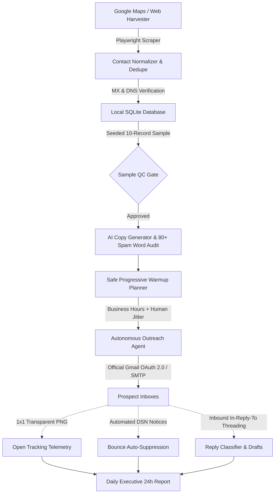

<div align="center">

# ⚡ REACHY
### Autonomous B2B Lead Generation & Cold Email Outreach Engine

[](https://www.python.org/)
[](LICENSE)
[](https://github.com/isiraglobal/Reachy/actions)
[](https://modelcontextprotocol.io/)
[](https://www.sqlite.org/)
[](docs/SECURITY.md)
[](CONTRIBUTING.md)

**A complete, self-hosted outbound sales infrastructure built by ISIRA Automations.**  
Discover verified B2B leads via Google Maps & web crawling, generate evidence-backed personalized copy, ramp sending limits with progressive warm-up, and dispatch campaigns autonomously with zero third-party subscription fees.

[Features](#-key-features) • [Why Reachy](#-why-reachy-vs-traditional-saas) • [Architecture](#-architecture) • [Quickstart](#-quickstart-in-60-seconds) • [Google OAuth](#-google-oauth-20-one-time-setup) • [CLI Commands](#-cli-command-reference) • [MCP Tools](#-model-context-protocol-mcp) • [Documentation](#-documentation)

---

</div>

## 💡 What is Reachy?

Most cold outreach platforms (Instantly, Lemlist, Apollo) charge $100–$500/month, lock your lead data inside their servers, and risk your domain reputation with aggressive, unjittered sending.

**Reachy is an open-source, self-hosted alternative.** It runs locally on your machine or private VPS, stores all leads and state in a durable SQLite database, and acts as an autonomous sales agent with built-in compliance, progressive account warm-up, AI copy generation, open-rate telemetry, and automated bounce handling.

---

## 🥊 Why Reachy vs Traditional SaaS?

| Feature | Reachy | Instantly / Lemlist / Apollo |
| :--- | :---: | :---: |
| **Pricing** | **100% Free & Open Source** | $99 – $400 / month |
| **Data Ownership** | **100% Local SQLite** (Your machine) | Hosted on third-party servers |
| **Lead Scraping** | **Included** (Playwright Google Maps & Web) | Paid credits ($0.10–$0.30/lead) |
| **Progressive Warm-up** | **Built-in Safe Ramp Curve** (5 → 50/day) | Requires extra subscription |
| **Sending Jitter** | **Human randomized (+/- 20%)** | Often rigid / robotic timing |
| **Credential Security** | **Fernet 256-bit symmetric encryption** | Plaintext / Cloud stored |
| **Email Providers** | **Official Gmail API (OAuth 2.0) & SMTP/IMAP** | Varies / Often requires app passwords |
| **AI Personalization** | **Direct BYOK (OpenAI/Anthropic/Local)** | Marked-up per-generation token cost |
| **Agent Integration** | **Native Model Context Protocol (MCP)** | Closed / REST API only |

---

## 🏗️ Architecture



---

## 🚀 Key Features

### 1. 🗺️ Google Maps Lead Harvester & Contact Crawler
- Extracts local business names, addresses, phones, websites, ratings, and review counts using Playwright.
- Crawls public contact pages, decodes Cloudflare email obfuscation, extracts JSON-LD metadata, and normalizes phone/email formats.
- Performs automated MX and DNS domain verification without guessing addresses.

### 2. ✍️ Evidence-Based AI Copywriting & Spam Filter Audit
- Generates tailored subject lines and email copy across 4 battle-tested frameworks:
  - **`work_done_first`**: Highlights immediate observations or prep work done for the prospect.
  - **`casual_observation`**: Short, low-pressure feedback tailored to their specific niche.
  - **`problem_solver`**: Pinpoints a visible gap and proposes a direct remedy.
  - **`executive_concise`**: 3-sentence, high-clarity value proposition for decision makers.
- Audits drafts against an internal catalog of **80+ high-risk spam trigger phrases** (e.g., *"100% free"*, *"risk-free"*, *"act now"*).

### 3. 🛡️ Safe Progressive Warmup Ramp
- Exponential ramp schedule designed specifically for Gmail and private SMTP limits:
  $$\text{Day 1: } 5 \longrightarrow \text{Day 2: } 10 \longrightarrow \text{Day 3: } 18 \longrightarrow \text{Day 4: } 28 \longrightarrow \text{Day 5: } 40 \longrightarrow \text{Day 6+: } 50 \text{ max}$$
- Enforces sending strictly within **business hours (09:00 – 17:00 UTC)**.
- Automatically skips weekends and adds **human-like randomized jitter (+/- 20%)** between sends.

### 4. 📬 Zero-Trust Google OAuth 2.0 & TLS SMTP
- Official Google OAuth 2.0 installed-app flow with local loopback callback server.
- Supports setting credentials via `.env` without juggling JSON credential files.
- Tokens are encrypted at rest with Fernet symmetric encryption before touching SQLite.
- Immediate remote token revocation and local secret wiping on disconnect.

### 5. 📊 Open Telemetry & Automated Bounce Suppression
- Injects a lightweight, non-blocking 1x1 transparent tracking pixel with tamper-proof HMAC tokens.
- Automatically captures incoming bounce notices (550 Mailbox not found, Delivery Status Notifications) and appends bad addresses to the global suppression database.

### 6. 🤖 Autonomous Agent Dispatch Loop
- Pre-flight account health checks ensure senders are active, unpaused, and within daily quota.
- Automatic follow-up cancellation whenever a prospect replies, unsubscribes, or files a complaint.
- Single command execution: `reachy agent send --pace 15` runs the complete autonomous dispatch loop.

### 7. 📑 Executive 24-Hour Daily Reports
- Generates executive daily summaries: messages sent, delivery rate, open rate, replies classified, and bounced contacts.
- Exports to clean GitHub markdown or dispatches directly to an operator email.

---

## 🔑 Google OAuth 2.0: One-Time Setup

To connect Gmail without storing plain passwords or risking inbox compromise, Reachy uses Google's official OAuth 2.0 installed-application flow.

#### Required Scopes (Configure once in Google Cloud Console)

| Scope | Security Rationale |
| :--- | :--- |
| `https://www.googleapis.com/auth/gmail.send` | **Outbound Transmission Only**: Permits sending outreach messages. Never touches existing personal emails, drafts, or trash. |
| `https://www.googleapis.com/auth/gmail.readonly` | **Reply & Bounce Tracking**: Read-only access to match thread headers (`Message-ID`) and detect automated delivery failure notices (DSNs). |
| `openid` & `email` | Confirms user identity and guarantees the authorized account matches the registered sender address. |

*(Broader, dangerous scopes like `mail.google.com` or `gmail.modify` are strictly blocked).*

👉 **Follow the complete walkthrough in [docs/GMAIL_OAUTH_SETUP.md](docs/GMAIL_OAUTH_SETUP.md).**

---

## ⚡ Quickstart in 60 Seconds

### 1. Installation

Requires Python 3.10+. Tested on Python 3.10 – 3.13.

```bash
git clone https://github.com/isiraglobal/Reachy.git
cd Reachy
python3 -m venv .venv
source .venv/bin/activate
pip install -e ".[browser,gmail,dev]"
python -m playwright install chromium
```

### 2. Environment Configuration

```bash
cp .env.example .env
```

Edit `.env` to configure your settings (see [`.env.example`](.env.example) for documented template):
```bash
REACHY_GOOGLE_CLIENT_ID=your-client-id.apps.googleusercontent.com
REACHY_GOOGLE_CLIENT_SECRET=GOCSPX-your-secret
REACHY_TEST_RECIPIENT=your-test-email@example.com
```

### 3. Initialize & Diagnose

```bash
reachy init
reachy doctor
```

### 4. Discover Leads

```bash
reachy discover "Architectural lighting studios in Chicago IL" \
  --limit 25 --list chicago_studios --backend playwright
```

### 5. Sample, Review & Approve List

```bash
reachy list sample --list chicago_studios --size 10 --seed 42
reachy list review --review-id 1 --incorrect 2,7 --notes "outside target geography"
reachy list approve --list chicago_studios --reviewer "Founder"
```

### 6. Connect Sender Account

```bash
# Gmail (via .env credentials):
reachy accounts add-gmail --email you@domain.com --permitted-use-acknowledged --open-browser

# Or standard SMTP:
reachy accounts add-smtp --email you@domain.com --host smtp.domain.com --permitted-use-acknowledged
```

### 7. Plan & Launch Campaign

```bash
# Generate AI copy variants
reachy copy generate --company "Apex Lighting" --city "Chicago" --style work_done_first

# Create, preview, and approve campaign
reachy campaign create --name "Chicago Q4" --list chicago_studios --account 1 \
  --steps steps.json --policy policy.json --sender-identity "Alex, Partnerships" --test-send

reachy campaign preview --id 1
reachy campaign approve --id 1 --by "Founder"
reachy campaign start --id 1

# Run the autonomous sending loop
reachy agent send --campaign 1 --max 10 --pace 15
```

---

## 💻 CLI Command Reference

```text
reachy init                 Initialize SQLite database and run versioned migrations
reachy doctor               Comprehensive diagnostic for config, database, providers, browser
reachy pause                Global kill-switch to immediately pause all active outreach
reachy import               Import existing JSON/CSV lead lists with deduplication
reachy discover             Playwright-assisted Google Maps lead harvester
reachy leads                Inspect and query normalized lead records
reachy list                 Manage lists, seeded QA sampling, human reviews, and approval gate
reachy copy                 Copy styles catalog, sample preview, AI generator, spam filter audit
reachy warmup               Inspect account progressive warm-up status and daily limits
reachy accounts             Connect (Gmail OAuth / SMTP), verify health, or disconnect senders
reachy campaign             Create, preview, approve, plan batches, run, pause, and reconcile
reachy agent send           Run the autonomous outreach dispatch loop with safety gates
reachy tracking             Inspect 1x1 tracking beacon open stats and delivery metrics
reachy replies              Sync IMAP/Gmail replies, classify intent, and manage draft replies
reachy bounce               Record bounces and manage auto-suppression
reachy suppress             Inspect and manage the global suppression list
reachy health               Sender health analysis, failure ratios, and auto-pause status
reachy report               Generate 24-hour executive outreach and deliverability report
reachy export               Export lead and campaign datasets to CSV/JSON
reachy backup / restore     Durable SQLite database backup and point-in-time recovery
reachy audit                Query append-only cryptographic audit trail
reachy browser              Playwright browser diagnostics and session profile manager
```

Use `--json` before any subcommand for automated script integration (e.g., `reachy --json health`).

---

## 🔌 Model Context Protocol (MCP)

Reachy includes a native MCP stdio server, allowing AI agents in **Claude Desktop**, **Cursor**, or **Codex** to harvest leads directly from your conversations:

```json
{
  "mcpServers": {
    "reachy": {
      "command": "python3",
      "args": ["-m", "google_maps_leads.mcp_server"],
      "cwd": "/path/to/Reachy"
    }
  }
}
```

**Exposed MCP Tools**:
- `extract_google_maps_leads`: Harvester for local businesses by keyword and location.
- `scrape_leads`: Targeted extraction from business URLs.
- `search_and_extract`: Multi-step query discovery and contact parsing.
- `browser_diagnostics`: Playwright runtime health inspection.

---

## ⚖️ Compliance & Deliverability Guardrails

Reachy is built specifically to protect your domain reputation and maintain strict regulatory compliance:
- **Zero Fabrication**: Reachy never guesses addresses. Only explicitly published emails on domains with valid MX records are marked for outreach.
- **Pre-Send Policy Gate**: Every send requires verified jurisdiction (`US`), lawful basis documentation, and an active sender identity.
- **Global Suppression Precedence**: Any recipient who clicks unsubscribe, replies with opt-out keywords, or triggers a bounce is permanently excluded across all campaigns.
- **Automatic Health Throttling**: If bounce rates exceed 5% or complaint signals occur, accounts are automatically paused.

---

## 📚 Documentation

- [Google OAuth Setup Guide](docs/GMAIL_OAUTH_SETUP.md)
- [Configuration & Environment Variables](docs/CONFIGURATION.md)
- [Installation Guide](docs/INSTALL.md)
- [Security & Credential Architecture](docs/SECURITY.md)
- [Compliance & Legal Guardrails](docs/COMPLIANCE.md)
- [Agent Operational Guide](AGENTS.md)
- [Troubleshooting](docs/TROUBLESHOOTING.md)
- [Historical Audit](docs/AUDIT.md) & [Implementation Plan](docs/PLAN.md)

---

## 🤝 Contributing

Contributions are welcome! Please read [CONTRIBUTING.md](CONTRIBUTING.md) for our code of conduct, safety policies, and development setup.

## 📄 License

Distributed under the **MIT License**. Built with pride by **ISIRA Automations**.
